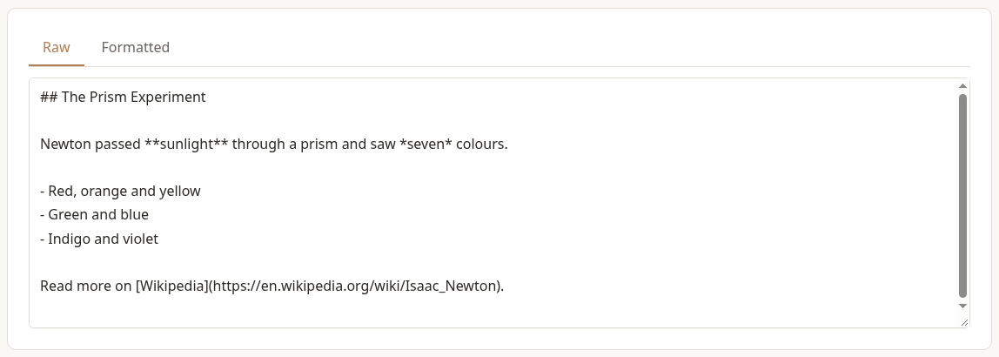
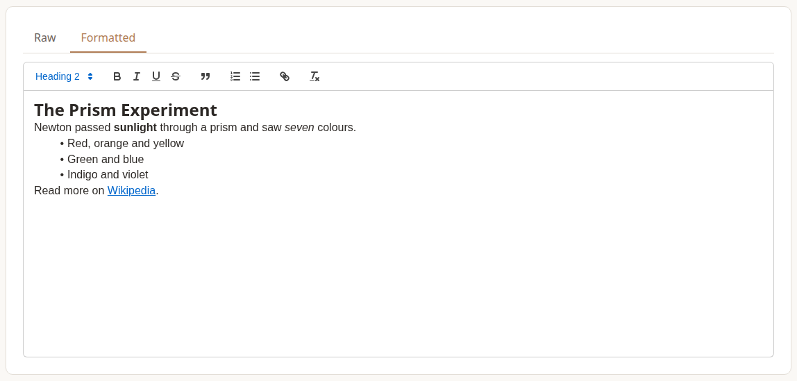

Blog posts and recipes are saved as **Markdown**: plain text with a few symbols that mark headings, bold text, lists and links. You don't have to learn it. The body editor has two tabs, and you can use either:

- **Formatted** works like a word processor, with buttons for headings, bold, lists and links. It's the tab you start on.
- **Raw** shows the Markdown itself.

Switch between them at any time. Whichever tab you save from, the body is stored as Markdown.





## The Basics

| To get | Type |
| --- | --- |
| A heading | `## Heading` (or `###` for a smaller one) |
| **Bold** | `**bold**` |
| *Italic* | `*italic*` |
| A bulleted list | a `-` and a space at the start of each line |
| A numbered list | `1.`, `2.` and so on at the start of each line |
| A link | `[the text to show](https://example.com)` |
| A quotation | `>` and a space at the start of the line |
| `Code` | the word in backticks: `` `code` `` |

Leave an empty line between paragraphs, and before and after a list. A single line break starts a new line within the same paragraph.

## Code Blocks

Put three backticks on the line before and after the code, with the language after the first three for colouring:

````
```ruby
puts "Hello, Newton"
```
````

The Formatted tab has no button for code blocks. Write them in Raw, and save from Raw.

## Images

Posts can't have pictures uploaded into their body from the editor. To publish a post with images in the text, import it as a ZIP file with its images (see *Importing And Downloading Blog Posts*). The post's own **Blog Image** is chosen on the form.

## What Doesn't Show

- **Tables** aren't shown in posts or recipes yet. Write the information as a list instead.
- **Crossed-out text** (`~~like this~~`, or the strikethrough button) shows as plain text.
