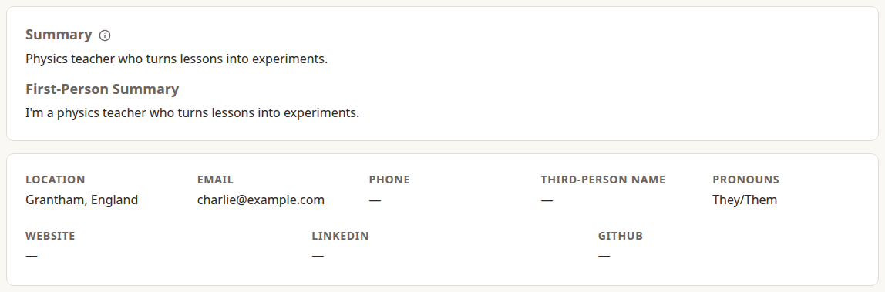
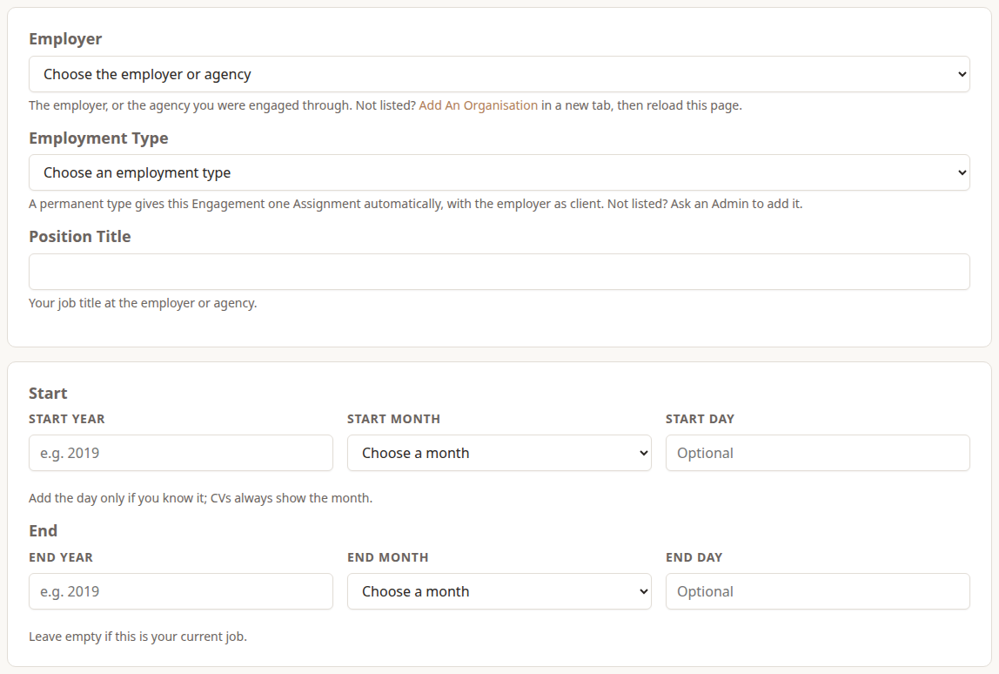
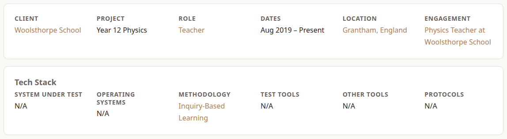
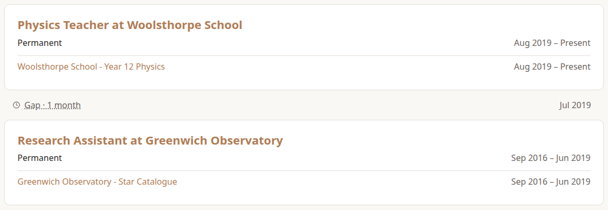

Dossier keeps your whole working life in one place, so you can make a CV for any job without deleting anything. Content Creators and above can use it. Everything you add is **Restricted**: other users never see it, though admins can.

The idea is simple: you enter everything once, here, and every CV is **made from it**. You never edit a CV by hand, and leaving something off one CV doesn't remove it from the next.

## Your Profile

**My Career › Profile** holds what goes at the top of a CV: your **Display Name**, a one-line **Headline**, your **Location** and contact details (email, phone, website, LinkedIn, GitHub).

A **Photo** (a JPEG, PNG or WebP under 5 MB) shows beside your name on the Profile page. Without one, your picture from **Settings** is used, and without that a person icon. **Remove Photo** on Edit Profile takes it off again.

Your summary can be written three ways, for different CVs:

- **Summary:** the short form, with no "I" and no name: "Physics teacher who turns lessons into experiments." Used whenever a CV has no version of its own.
- **First-Person Summary** (optional): "I'm a physics teacher who…", for cover letters and LinkedIn.
- **Third-Person Summary** (optional): uses your **Third-Person Name**, "Charlie teaches…", for bios.

## Engagements and Assignments

Your career is made of two kinds of record:

- An **Engagement** is who employed you: the employer (or agency), your **Position Title**, the **Employment Type** and the dates.
- An **Assignment** is where the work was done: the **Client**, your **Role** there, an optional **Project**, the dates, **Location** and whether it was **Remote**. Every Assignment belongs to an Engagement, and its dates must fall inside the Engagement's.

A permanent job has one Assignment, at the employer itself, and Dossier creates it for you. A consultant or contractor usually has several Assignments under one Engagement, one for each client.

To add a job, choose **Actions › New › Create An Engagement**:

- Dates need a year and month. Add the day only if you know it. CVs always show the month.
- Leave **End** empty for your current job.
- The employer must already be an Organisation. If it isn't, **Add An Organisation** first (see *Managing Dossier Reference Data*).

Then add Assignments with **Add Assignment** on the Engagement's page, or **Actions › New › Create An Assignment**.

A new Assignment goes to the top of its Engagement. To change the order, for example to put a more important Assignment first, use the **Up** and **Down** arrows beside each Assignment on the Engagement's page. The Timeline shows the same order. Any bench time is listed after the Assignments.

The Engagement's **Employment Type** links to that type's page, which lists all your Engagements of that type with their Assignments.

### An Assignment's page

Each Assignment has a **Tech Stack**: what you worked with. Name the **System Under Test**, or tick its **N/A** box. Below it is a field for each Skill Category, such as Testing, Databases and Operating Systems, in the order the Assignment page shows them, plus **Other Skills** for anything else. Type the items separated by commas and leave the rest empty. A new name becomes a Skill in that field's category; an existing Skill keeps its own.

An Assignment's page also has panels for its **Achievements**, **Training**, **Colleagues**, and **Vendors & Customers**. Colleagues, vendors, customers and their staff are private notes: only you and admins see them, and they never appear on a CV.

Each Colleague or Staff member is a person in **Occasions › People**. On **Add A Colleague** (or **Add Staff**), start typing a name under **Find A Person** and choose **Select** to link someone already in People. If they aren't there, fill in their name and they're added as a new **Restricted** person, so only you and admins see them. Their name, **Email** (their Work Email) and **LinkedIn** belong to the person, so they're the same on every Assignment, and you can change them from the Colleague's form if the person is yours. **Position** and **Comment** belong to this Assignment. Deleting a Colleague keeps the person. Each row starts with the person's photo, from their image in People, or a person icon if they have none. Choose it to open the person.

An Engagement's page has a **Colleagues** panel too, for people you worked with during that Engagement but on no Assignment you shared, such as fellow consultants at the same employer. You add, find and edit them the same way, with **Add A Colleague** on the Engagement's page. The same person can be a Colleague on the Engagement and on any of its Assignments.

## The Timeline

**My Career › Timeline** lists your Engagements newest first, each with its Assignments.

It also shows where your career has holes:

- A **Gap** is time between Engagements.
- **Bench** is time inside an Engagement that no Assignment covers, common for consultants between clients.

Choose a Gap or Bench period to see what you did then, such as courses you took.

Personal projects (an Engagement whose Employment Type is Personal) appear on the Timeline marked **Personal**, but never fill or hide a gap.

The **Professional** and **Personal** boxes at the top choose which Engagements the Timeline shows. Both are ticked at first, and your choice is remembered for next time. Unticking Personal doesn't change the gaps; unticking Professional hides them along with the Engagements.

## Deleting

- **Deleting an Engagement** hides it and its Assignments. You can restore it from **Actions › New › Deleted Engagements** for 30 days. Its Assignments come back with it.
- **Deleting an Assignment** hides it, with its Achievements and Training. You can restore it from **Actions › New › Deleted Assignments** for 30 days, as long as it still fits within its Engagement's dates. After that it's gone for good, with its Achievements; its Training moves up to the Engagement.
