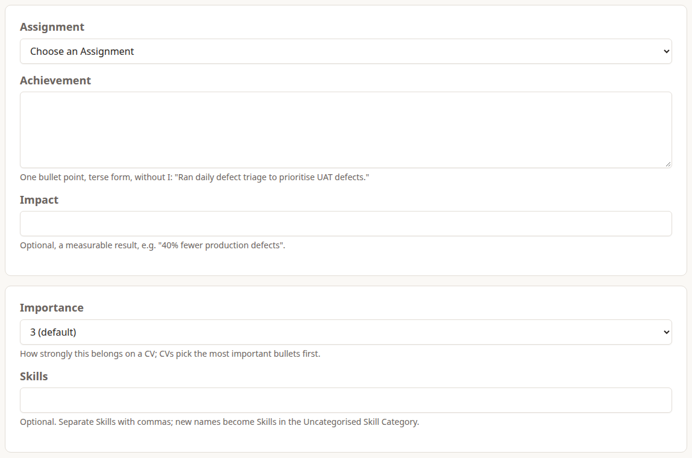
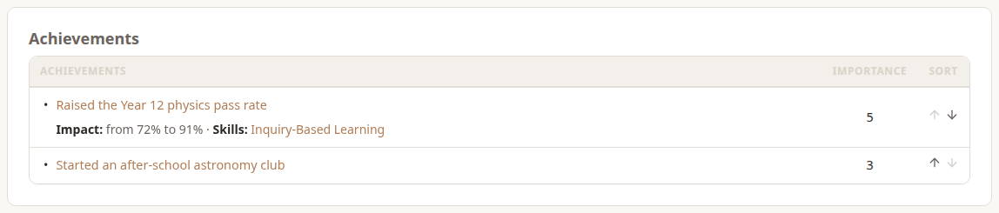
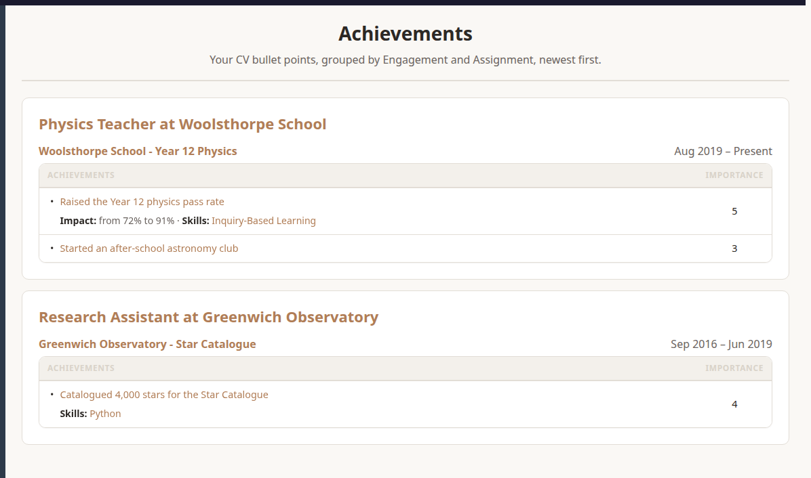

**Achievements** are the bullet points on your CV. Each one belongs to an Assignment, and you write it once: every CV picks from the same list.

## Writing One

Choose **Add Achievement** on an Assignment's page, or **Actions › New › Write An Achievement** and choose the Assignment.

- **Situation** (optional): the context, for interview-style examples, such as "Two vendors blamed each other for outages." Only you and admins see it, and it's never on a CV.
- **Achievement:** one bullet point, in short form without "I": "Raised the Year 12 physics pass rate." It reads the same on every CV, whatever voice the CV uses.
- **Impact** (optional): a measurable result, such as "from 72% to 91%". CVs show it after the text.
- **Importance:** 1 to 5, 3 by default. CVs include the most important Achievements first, so this is how you choose what makes a short CV.
- **Skills** (optional): the Skills it shows, separated by commas. A name Dossier doesn't know becomes a new Skill in the **Uncategorised** category. Tagging an Achievement with a Skill counts that Assignment towards your years with it. Tag soft skills too, such as **Leadership** or **Stakeholder Management**: see Professional Skills under Skills and Experience.

## Your Achievements

An Assignment's page lists its Achievements in order. Use the arrows in the **Sort** column to move one up or down. CVs keep this order.

**My Career › Achievements** lists them all, grouped by Engagement and Assignment, newest first.

## Editing and Deleting

Open an Achievement to **Edit Achievement** or **Delete Achievement**. Deleted Achievements are kept for 30 days: restore one from **Actions › New › Deleted Achievements**. After that it's gone for good.

An Achievement can't be moved to another Assignment. Deleting an Assignment hides its Achievements with it, and restoring the Assignment brings them back (see *Your Profile And Timeline*).
