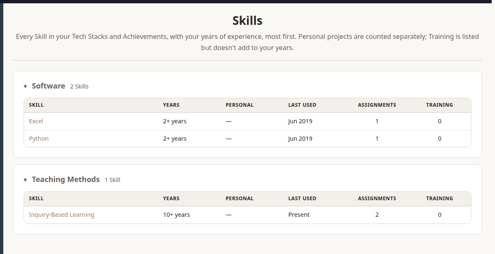
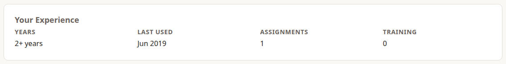
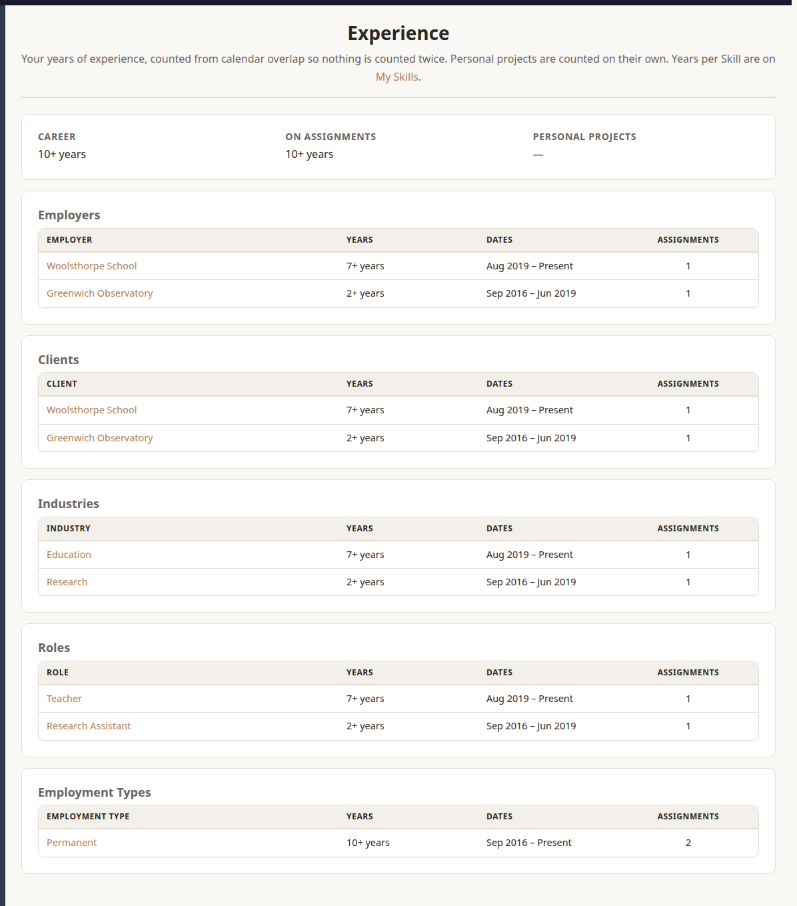

Dossier works out your years of experience from your dates, so you never have to count them by hand.

## How Years Are Counted

- Years come from **calendar overlap**, month by month. Two Assignments at the same time count once, so nothing is counted twice.
- A job that's still running counts up to today.
- Under a year shows as months ("8 months"). A year or more shows as whole years ("7+ years").
- **Personal projects** are counted on their own and never added to your professional years.
- **Training** shows that you learned a Skill. It doesn't add to your years.

## Your Skills

**My Career › Technical Skills** lists every technical Skill in your Tech Stacks and Achievements, grouped by Skill Category, most years first.

An Assignment uses a Skill when the Skill is in its Tech Stack or tagged on one of its Achievements.

Choose a Skill to open its page. Everyone can see a Skill's name and description, but only you see **Your Experience** with it, and the Assignments, Achievements and Training that use it. **Your Contributions** lists your talks, articles and other Contributions tagged with it, newest first, even if you've never used the Skill on an Assignment.

## Soft Skills

Soft skills, such as **Leadership**, **Stakeholder Management** or **Communication & Presentation**, live in the **Soft Skills** category. Tick them on an Achievement's or a Contribution's form, under **Soft Skills**. Typing one in Technical Skills works too, as does the wording job ads use: typing "Flexibility and Adaptability" tags **Adaptability**.

They aren't counted in years. **My Career › Soft Skills** lists every Soft Skill with your examples of it: each Achievement with its Situation, Task, Impact and Assignment, most important first, then each Contribution. A Soft Skill with none says **No examples yet**. That's where to look when an application or interview asks for an example of a skill. A Soft Skill's own page lists its Achievements and Contributions too, under **Your Examples**. Soft Skills never appear in a CV's skills.

Admins can make any Skill Category soft, by ticking **Soft Skills** on its Edit page. Its sub-categories are then soft too.

### Adding and tidying Skills

New Skills appear as you type them into a Tech Stack, Achievement or Credential. They land in the **Uncategorised** category. To file one properly, ask an admin, or add the Skill yourself first with **Actions › New › Add A Skill** and choose its category.

- **Aliases** are other spellings of the same Skill. Typing an alias finds the Skill instead of making a new one.
- **Version Of** makes one Skill a version of another: Windows XP of Windows. A version's years also count for its parent, and CVs show the family together as "Windows (XP, Vista)".

Admins can **merge** two Skills that turn out to be the same (see *Managing Dossier Reference Data*).

## Experience

**My Career › Experience** totals your career at the top, then breaks it down by Employer, Client, Industry, Role and Employment Type, each with years, dates and the number of Assignments.

- **Career** counts every Engagement, including bench time but not gaps.
- **On Assignments** leaves the bench out.
- An Assignment without a Role is listed under **No Role**, so you can see what's missing.

Organisation, Industry, Role and Employment Type pages also show your experience with that item, at the top.
