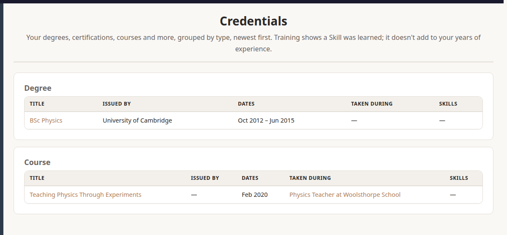

**Credentials** are your degrees, diplomas, certifications, awards, courses and workshops. Courses and workshops are **Training**.

## Adding One

Choose **Actions › New › Add A Credential**, or **Add Training** on an Engagement's or Assignment's page.

- **Type:** Degree, Certification, Course and so on.
- **Title**, and **Issued By**: the university, issuer or training provider. It's optional, for self-study.
- **Engagement** and **Assignment** (optional): the job you took it during. Leave both empty for a course on the bench or between jobs, or for a degree.
- **Status:** **To Do** (not started yet: **Started** may be empty), **In Progress** or **Completed**. Leave it on **From the dates** and it's Completed when there's a Completed date, else In Progress. A CV leaves To Do out.
- **Started** and **Completed:** a year on its own is fine; add the month and day if you know them. For a one-day course, give the same date for both. Leave **Completed** empty until the status is Completed.
- **Expires** (optional): for a certification that needs renewing. After a renewal, update this date and note the renewal in the description.
- **Credential ID** and **Verification URL** (optional): the certificate number, and where anyone can check it.
- **Hours** (optional), **Skills** (comma-separated, as on Achievements) and a **Description**.
- **Certificates** (optional): PDF, JPEG or PNG scans, up to 10 MB each. A Credential's page previews them. Only you and admins can see them.

## Your Credentials

**Credentials › Credentials** lists them in a frame per type, newest first. Click a frame's heading to fold it away (it's open again next time), and a column heading to sort by that column (again to reverse).

- Courses and other Training list only the **Completed** ones. **Issued By** opens Browse Courses at that provider.
- **Taken During** names the Engagement or Assignment, or **Personal Development** when there's neither.
- An expired Credential is marked **Expired** in the list.
- A Credential's page warns you when it has expired, or expires within 90 days.
- Training shows on the Engagement and Assignment it was taken during, and on the page of each Skill it covers. It doesn't add to your years of experience.

## Browse And Filter Courses

- **Credentials › Browse Courses** lists the providers you've taken Courses from; choose one to see its Courses, whatever their status.
- **Credentials › Filter Courses** narrows your Courses by **Issued By**, **Status**, **Skill**, **Year Completed** and words in the **Title**, in a table you can sort.

## A Credential's Page

Its frames are **Description**, with your certificates beside it (click one to open it), **Details** and **Verification**. Each folds away when you click its heading. **Expires** and **Hours** show only when they're set, and Verification only when there's a Credential ID or Verification URL; **Edit Credential** always has every field, in the same order as the page.

## Deleting

**Delete Credential** on its page removes it, and its certificate files, for good. There's no Deleted page for Credentials.
