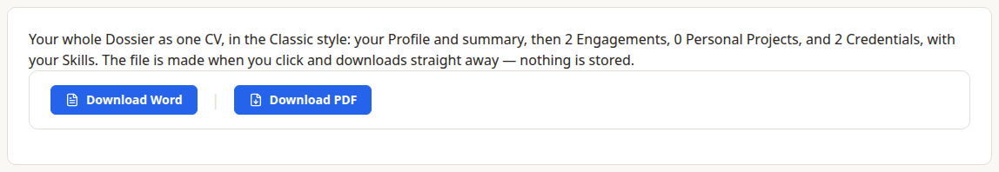
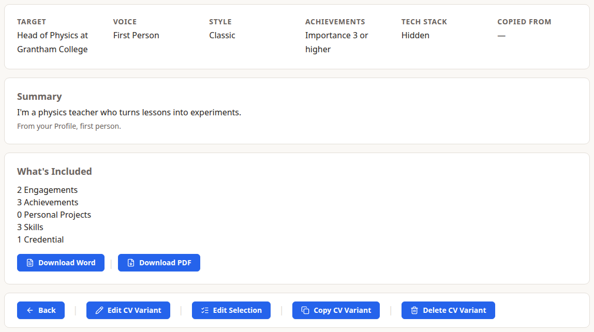
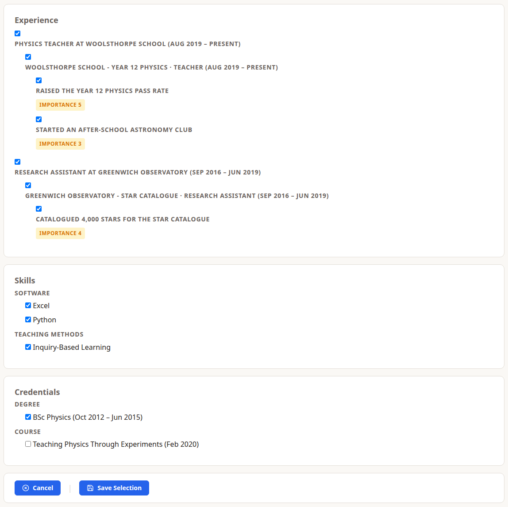

Dossier makes your CV for you, as a Word document or a PDF, from everything in My Career. Files are made when you choose download, and nothing is stored.

## Download Master CV

**Actions › Import & Export › Download Master CV** gives you everything as one CV: your Profile and summary, every Engagement with its Assignments, Tech Stacks and Achievements, Personal Projects, Skills by category, Credentials by type, and your Contributions under **Presentations & Community**, newest first, each as "Title — Event, Nov 2024".

Choose **Download Word** or **Download PDF**. Colleagues, vendors, customers and their staff are never on any CV.

## CV Variants

A **CV Variant** is a CV for one application: a choice of what to include, saved under a name. It never changes My Career, so leaving something out of one Variant doesn't remove it from the next.

Choose **Actions › New › Create A CV Variant**.

- **Name**, and optionally the **Target Company** and **Target Role**.
- **Copy From:** start from what another of your Variants includes.
- **Voice:** which Profile summary to use: First Person, Implied (your short Summary) or Third Person. Achievements read the same in every voice.
- **Minimum Importance:** Achievements of this importance or higher are included unless you untick them.
- **Show Tech Stack:** adds each Assignment's Tech Stack. Off by default.
- **Summary Override:** a summary written for this application only.
- **Job Description:** paste the advert, for reference. It's never on the CV.

### What's included

A new Variant starts from these rules:

- Jobs that ended in the last 10 years are shown in full, with their Assignments. Older ones are shortened to the title, employer and dates.
- Achievements at or above the Minimum Importance.
- Skills you have professional years in, except Uncategorised ones.
- Degrees, diplomas, certifications and awards. Training and expired Credentials are left out.
- Personal Projects are left out.
- Contributions are left out until you tick them, so a Variant's **Presentations & Community** section only appears once you tick at least one.

Choose **Edit Selection** to tick or untick anything. Your choices always win over the rules, and anything you add to My Career later is included or left out by the rules. **Reset To Defaults** clears your choices.

### Copying and deleting

**Copy CV Variant** starts a new Variant with this one's settings and choices. **Delete CV Variant** removes the Variant for good; your career data isn't touched.

Files are named after your Display Name, the Variant and the date, for example `Charlie_Content_Creator_CV_Head_of_Physics_Grantham_College_2026-11-02.pdf`.
