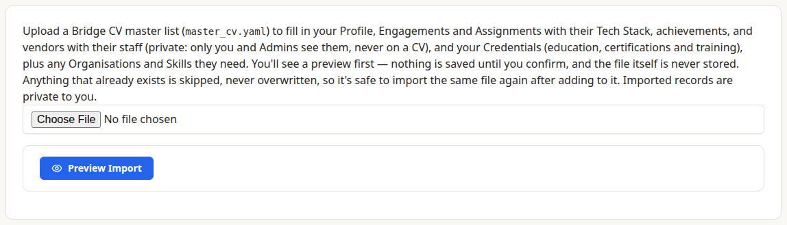

Instead of typing your career in by hand, you can import it from one file: a **master CV** in YAML, a plain-text format. Choose **Actions › Import & Export › Import Master CV**.



## How It Works

1. Choose the file, then **Preview Import**. Nothing is saved yet: the preview lists what would be created, what already exists, and any warnings or errors.
2. If it looks right, choose **Import**. It's all or nothing: if anything fails, nothing is saved.

- The file itself is never stored.
- Everything imported is private to you, like everything else in Dossier.
- **Nothing is ever overwritten.** Anything that already exists is skipped, so you can add to the file and import it again. Edits you've made in Dossier are kept.
- A re-import does add new Achievements and vendors to Assignments that already exist.

## What the File Holds

The file has up to five sections: `profile`, `organisations`, `skills`, `engagements` and `credentials` (with `education`, `certifications` and `training` lists). A short example:

```yaml
profile:
  name: Alex Example
  headline: Test Manager
  terse_summary:
    text: Test manager who tests things.

engagements:
  - employer: Acme Consulting
    employment_type: Consultant
    position: Test Consultant
    start: 2019-01
    end: current
    assignments:
      - client: Department of Examples
        role: Test Lead
        start: 2019-03
        end: current
        tech_stack:
          operating_systems: Windows 11
          methodology: Hybrid
          system_under_test: Licensing system
          test_tools: [Robot Framework]
          other_tools: N/A
          protocols: N/A
        terse:
          achievements:
            - Cut regression testing from five days to one.
```

New Organisations and Skills are created as needed. Employment Types, Roles, Industries, Locations, Skill Categories and Credential Types are Reference Data, which only admins can add: if your file names one that doesn't exist yet, the preview tells you, and an admin needs to add it before you import. (When an admin imports, they're created.)

## Downloading

**Download Master CV**, under the same menu, makes a Word or PDF CV from everything in Dossier. See *CVs And CV Variants*. There's no download back into the YAML format.
