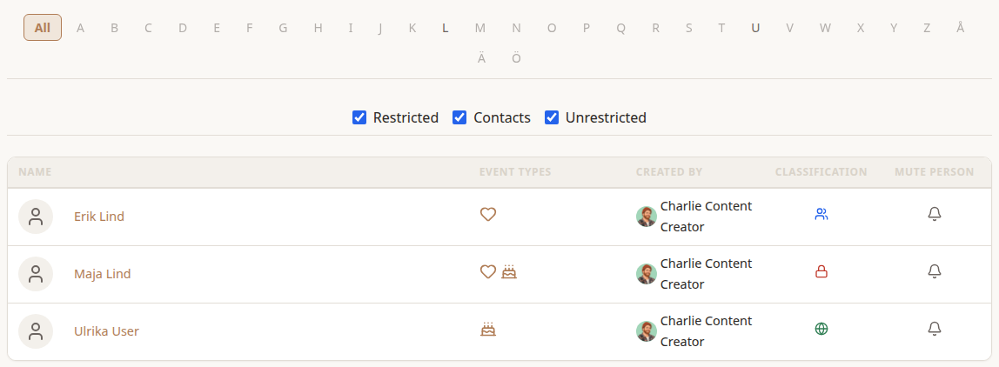
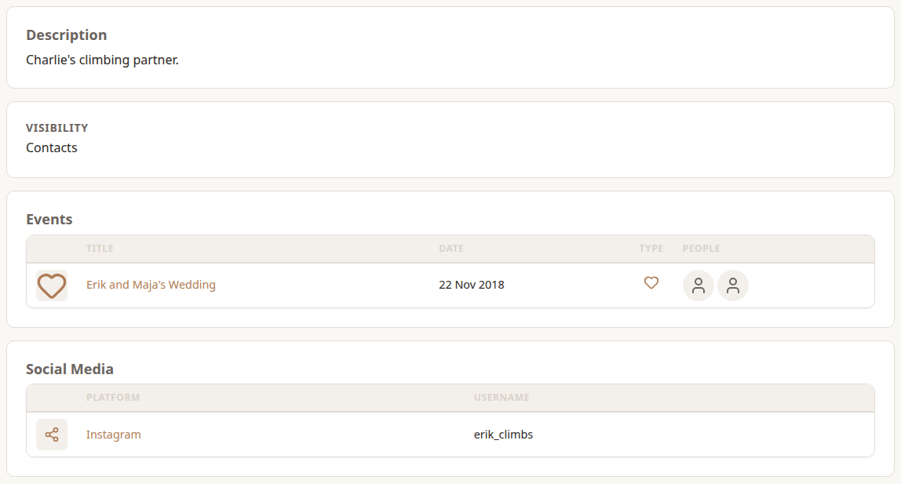

**People** in the left nav lists everyone you're allowed to see, ordered by last name.

## Finding someone

The letters across the top jump to people whose last name starts with that letter. Someone without a last name is filed under their first name. The Swedish letters Å, Ä and Ö come after Z. Letters with nobody under them are greyed out. **All** shows everyone again.

Each row shows the person's picture and name, icons for the kinds of events they have, who added them and their Visibility. Choose an Event Type icon to see every event of that type.

Signed in, you also get **Visibility** checkboxes, which start from your **Default Visibility** in *Preferences*, and a **Mute Person** button on each row. See *Muting* in *Viewing Events*.

## A person's page

Shows the person's picture, description, **Contact** (their Work Email, when they have one; anyone who can see the person sees it) and Visibility, then:

- **Events**: every event they're part of, ordered through the year.
- **Social Media**: the platforms they're on, with their username on each.

Their owner, or an admin, can edit or delete them from here.
