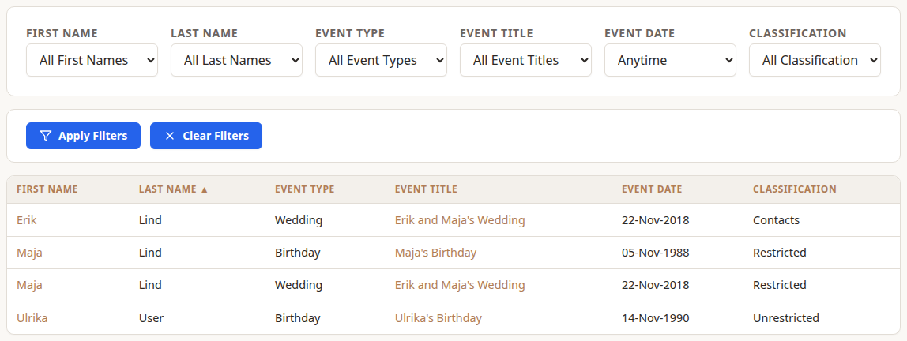
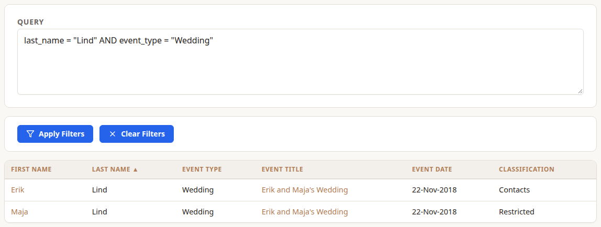

**Filter People and Events** lists people together with their events, one row for each person and event. Someone with no events gets a row of their own with the event columns left empty. Only people and events you're allowed to see are included.

Choose **Apply Filters** to narrow the list and **Clear Filters** to start again. Click a column header to sort by it, and click it again to reverse the order.

## Basic

Dropdowns for **First Name**, **Last Name**, **Event Type**, **Event Title**, **Event Date** and **Classification**. The name, type and title dropdowns only list values that appear in your visible rows, and choices are combined with AND.

Things worth knowing:

- **Event Date** offers Today, This Week, This Month and This Year. Each runs from the start of that period up to today, and compares the event's full date including its year. An event without a year never matches.
- **Classification** is the person's Visibility, not the event's.



## SQL

Write a query instead, for example:

```
first_name = "James" AND (event_type = "Birthday" OR title CONTAINS "Tour")
```



| Field | Example |
| --- | --- |
| `first_name`, `last_name` | `last_name = "Bergström"` |
| `event_type`, `title` | `title CONTAINS "wedding"` |
| `date` | `date >= "2000-01-01"` |
| `classification` | `classification = "contacts"` |

Combine conditions with `AND`, `OR` and brackets. `=`, `!=` and `CONTAINS` compare text without regard to case. Dates also take `>`, `<`, `>=` and `<=`. A query that can't be read shows an error under the box explaining what's wrong.
