>  I'm Gary. My friends Ulrika and Charlie kept mentioning this site, so I decided to try it out. I didn't have an account, so everything here is what you see as a **guest**.

This User Guide is told by the people who use the site, one chapter each: Gary the guest, Ulrika the signed-in user, Charlie the Content Creator, and Adam the admin. Each chapter builds on the one before it.

## The Home Page

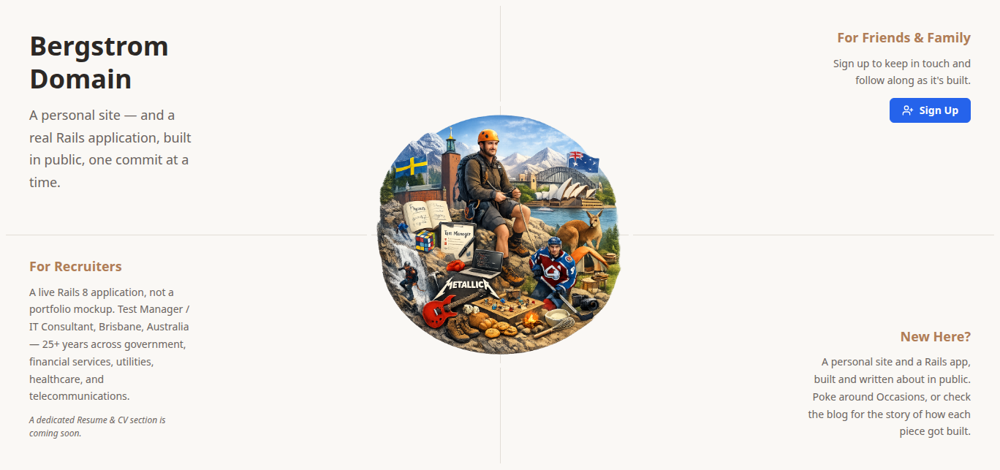

>  The home page is short: what the site is, who it's for, and a **Sign Up** button for friends and family. I left that for later and went looking around first.

## The Top Bar

The bar across the top is the same on every page. **Home** brings you back here, and **Sign In** sits on the right.

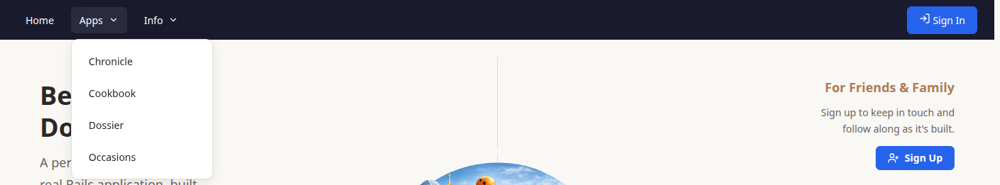

**Apps** lists the site's apps. Each one has its own landing page and its own menu down the left-hand side.

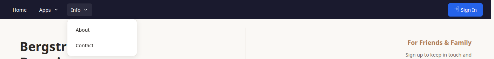

**Info** has pages about the site itself.

>  About tells you who runs the site, and Contact tells you how to reach them.

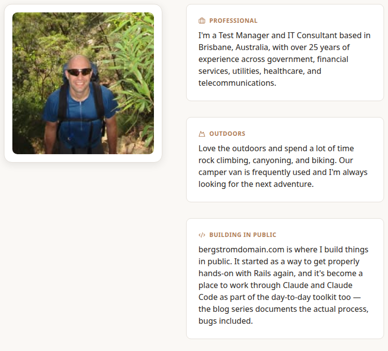

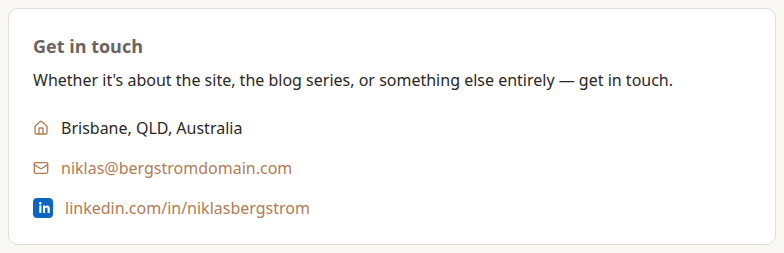

## Finding Your Way Around an App

>  Every app works the same way. Its landing page says what it's for, and the menu on the left takes you everywhere else. I didn't need to learn each app separately.

The left menu is split into the same groups in every app:

- **Views** are ways of looking at the app's content, such as browsing, filtering, or by date.
- **Reference Data** lists the categories the app's content is filed under, such as Blog Categories, Cuisines or Event Types.
- **Documentation** links to this User Guide.

Signed-in users get more groups. You'll meet them in later chapters.

### Chronicle

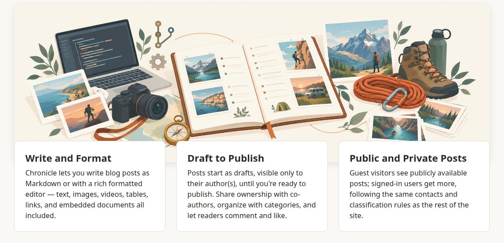

Chronicle is the site's blog. **Browse Blog Posts** walks down from a category to a subject and then a topic, showing the newest posts at each step. **Filter Blog Posts** narrows them down with a sortable table.

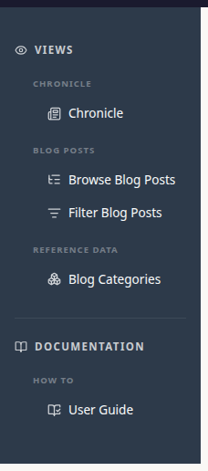

### Cookbook

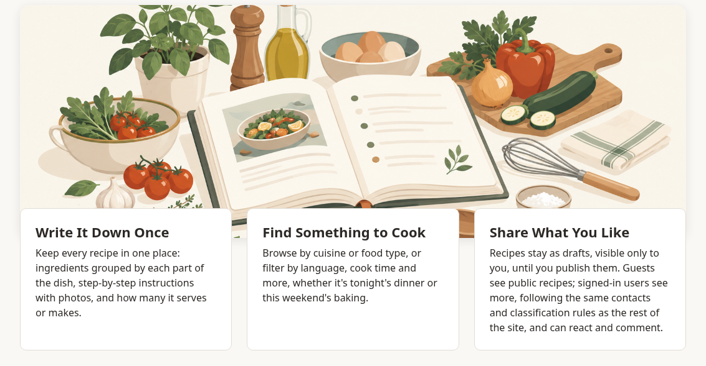

Cookbook holds recipes. Browse them **By Cuisine** or **By Food Type**, filter them, or find recipes that use the ingredients you have.

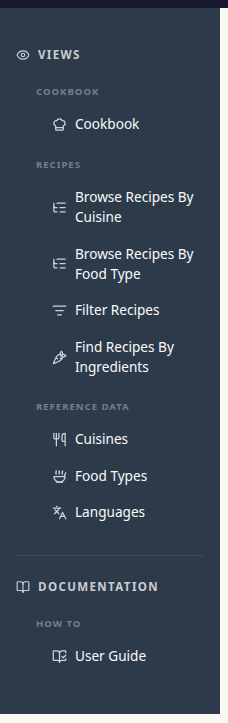

### Occasions

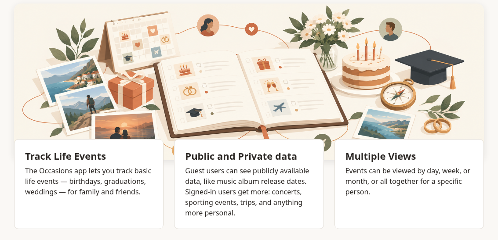

Occasions keeps track of people and the events in their lives, like birthdays and weddings. **Events By Day**, **Week** and **Month** show what's coming up. Events come round every year, so a birthday from 1990 shows up every November. **People** lists everyone, A to Z.

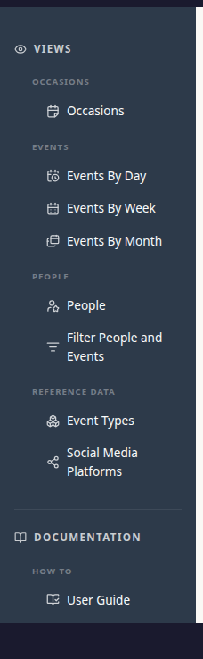

>  There's a fourth app, Dossier, but that one is for Content Creators. Charlie explains it in their chapter.

## What a Guest Can't See or Do

>  A few things surprised me.

### Less content than I expected

>  Charlie told me they'd written three posts about Isaac Newton, but I could only find one.

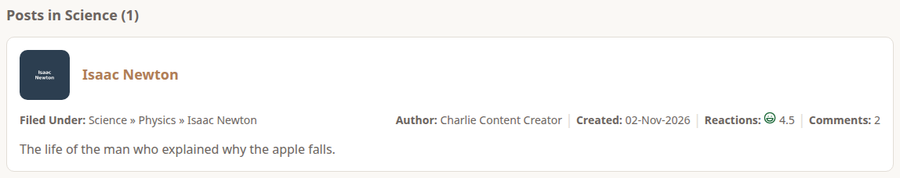

>  It was the same in Occasions. Charlie has three events in November, and I saw one.

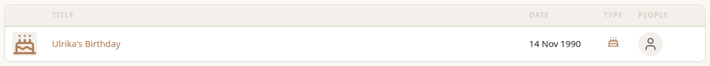

>  In Cookbook, Swedish showed no recipes at all, even though Charlie bakes kanelbullar every week.

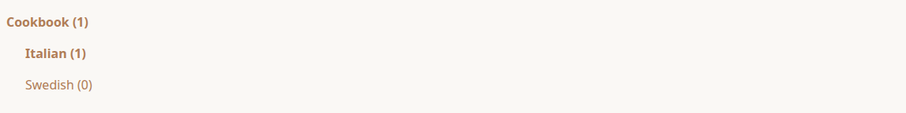

Nothing is broken. Whoever adds a post, event or recipe chooses who can see it. Guests only see what has been made **Unrestricted**, meaning visible to everyone. Charlie explains the other choices in their chapter.

### I could read comments, but not add any

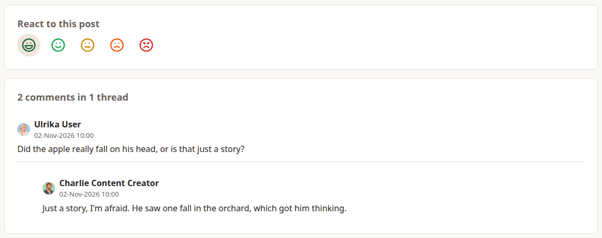

>  Ulrika had asked a question under Charlie's post, and Charlie had answered. I could read both, and see the reactions. But there was nowhere for me to write, and the faces did nothing when I clicked them.

Comments and reactions on blog posts and recipes need an account, because comments on this site are never anonymous.

### I couldn't add, change or delete anything

>  No app had a Create button, and nothing I opened had Edit or Delete. As a guest you can look, and that's all.

That was enough for me, so I signed up. That's the next chapter.
