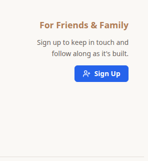
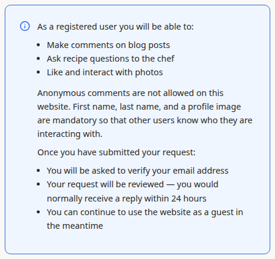
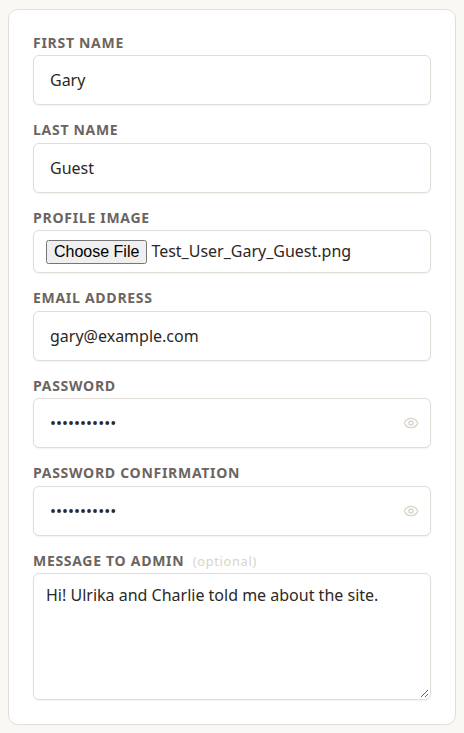
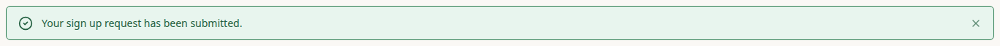

>  I wanted to join in, so I asked for an account. This is how that went.

## Step 1: Find the Sign Up Button

The **Sign Up** button is on the home page, under **For Friends & Family**.

## Step 2: Read What You're Signing Up For

>  The top of the page explained what an account would let me do, and that someone would review my request before it was approved.

## Step 3: Fill In the Form

- **First name**, **Last name** and **Profile image** are all required. Comments on this site are never anonymous, so other people need to see who they're talking to. Your name and picture appear beside everything you write.
- Your **Email address** and **Password** are what you'll sign in with.
- **Message to admin** is optional. It's your chance to say who you are.

>  I mentioned Ulrika and Charlie, so whoever read my request would know I wasn't a stranger.

## Step 4: Send Your Request

Choose **Sign Up**. You'll be taken back to the home page with this message:

## What Happens Next

Your request is now **pending**. A system admin reviews each request, normally within 24 hours, and approves it. Until then, keep using the site as a guest.

>  Once my request was approved, I could sign in with my email address and password, using **Sign In** in the top bar. Ulrika takes over in the next chapter and shows what you can do once you're in.
