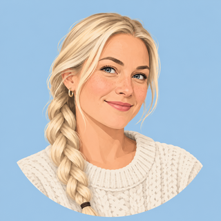

>  I'm Ulrika. I've had an account for a while. I'm a **user**: I can't write posts or recipes, but I can join in with what other people share. Here's what changes once you've signed in.

## Signing In

Choose **Sign In** in the top bar and enter your email address and password. Once you're signed in, your menu replaces the Sign In button.

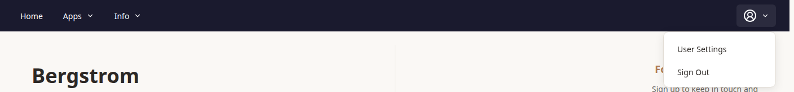

**User Settings** is where you look after your account, your contacts and your preferences. **Sign Out** is next to it.

## Comments and Reactions

>  The first thing I did was ask Charlie about their Isaac Newton post.

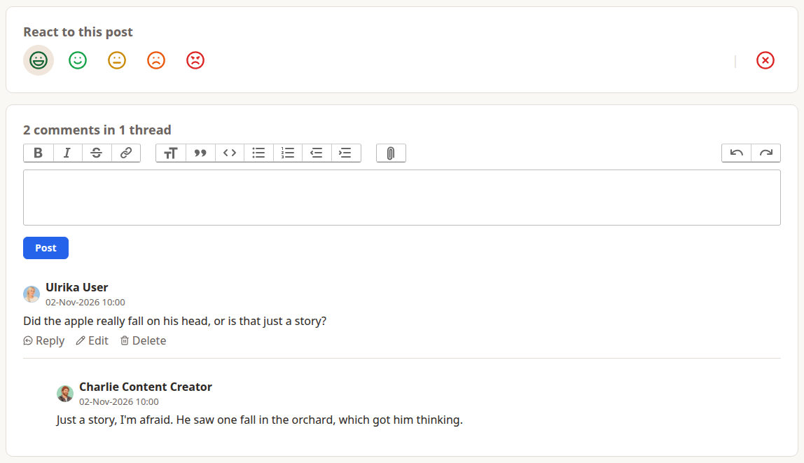

Blog posts and recipes work the same way.

- **Reactions:** pick one of the five faces, from grinning to angry. Your face is highlighted, and you can change it at any time. The ⊗ on the right takes your reaction back. The score shown on the post or recipe is everyone's reactions averaged.
- **Comments:** write in the box and choose **Post**. Everyone who can see the post or recipe can see your comment, with your name and profile picture beside it.
- **Replies:** choose **Reply** under a comment to answer it. Replies are indented under the comment they answer, so a conversation stays together as one thread.
- **Your own comments:** you can **Edit** or **Delete** them at any time.

>  Charlie's lasagna recipe has the same panels, which is where I asked whether the meat sauce could be made the day before.

## Contacts

>  Gary was right: Charlie had shared more than either of us could see. Charlie keeps some things for friends only, so I had to become one of their **contacts**.

A contact is a two-way connection between two people with accounts. Some posts, events, people and recipes are shared with the owner's contacts only. Once you're connected, you see those.

### Sending a request

Open **User Settings** and choose **Contacts**, under Contact Management in the left menu.

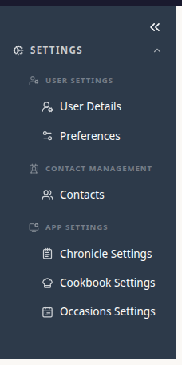

Start typing a name under **New Contacts**. People with an approved account whose name matches appear as you type. Choose the person icon next to them to send a request.

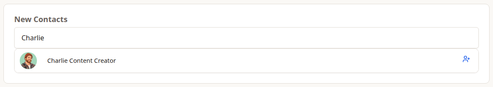

Your request then waits under **Outgoing Requests** until they answer. You can cancel it from there.

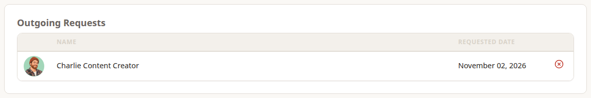

> **Meanwhile, at Charlie's end:** my request appeared on Charlie's own Contacts page under **Incoming Requests**. The ✓ accepts it and the ⊗ declines it. If Charlie had already sent me a request, mine would have connected us straight away.
>
> 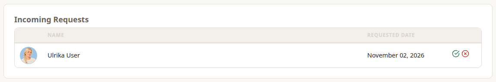

Once your request is accepted, the person moves to **My Contacts**. Either of you can remove the connection later.

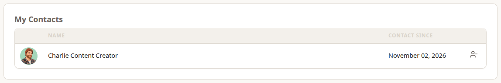

### What being connected changes

>  As soon as Charlie accepted, more of their content appeared.

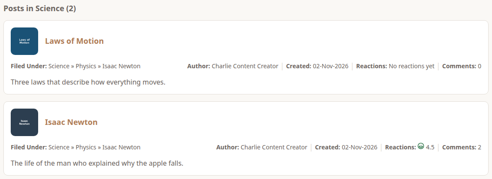

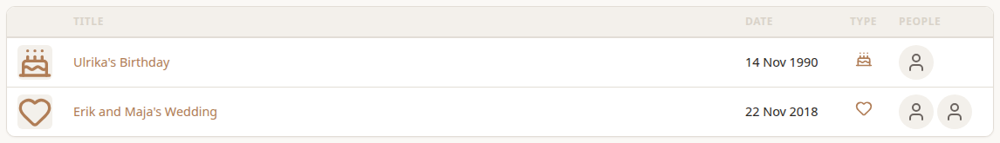

Charlie's **Laws of Motion** post and Erik and Maja's wedding are shared with Charlie's contacts, so I see them now. Gary still doesn't. The same goes for Charlie's kanelbullar recipe. Charlie's **Restricted** things stay private: Maja's birthday and the Universal Gravitation notes are for Charlie alone, and being a contact doesn't change that.

Every post, event, person and recipe has one of three visibilities:

- **Unrestricted:** everyone, including guests.
- **Contacts:** the owner's contacts, and the owner.
- **Restricted:** only the owner.

Admins can see everything. Charlie explains how to choose a visibility in the next chapter.

### Choosing what to see

>  Once you can see more, it helps to narrow things down. The **People** page in Occasions has a checkbox for each visibility. The full **Events** list has them too: choose **All** at the top of Events By Month.

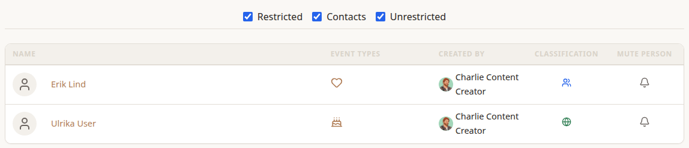

Untick a box to hide that visibility. For example, tick only **Contacts** to see just what your contacts have shared with you. The icon in the Classification column shows each record's visibility. **Restricted** only ever shows your own records, so as a user who adds nothing, it shows nothing.

## Still No Create Buttons

>  Like Gary, I still have no **Actions** in the left menus, so I can't add posts, recipes, people or events. That needs a Content Creator account like Charlie's. There's no button to ask for one yet.

## Settings

**User Settings** in your menu opens your settings. The left menu has three groups.

### User Settings

- **User Details:** your profile picture, your email address and changing your password.
- **Preferences:** where you land after signing in, and which visibilities are ticked by default.

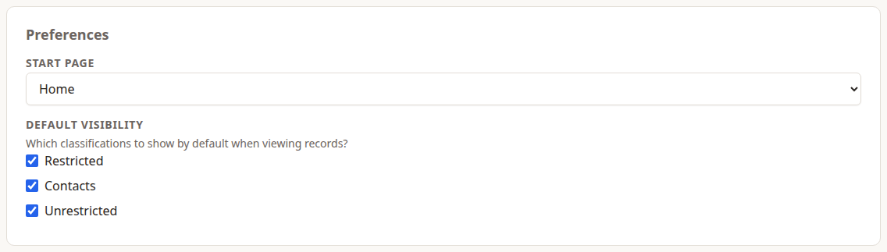

>  I set my **Start Page** to Occasions, so I go straight there when I sign in. **Default Visibility** decides which of the People and Events checkboxes start ticked.

### Contact Management

**Contacts** is the page described above.

### App Settings

Each app has its own settings page. The one that matters to a user is **Start Page**: where you land when you open that app.

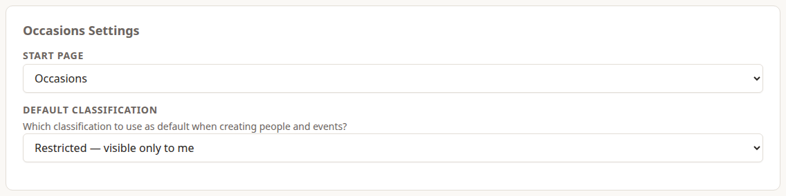

>  **Default Classification** is for people who create things. I can leave it alone. Charlie uses it, and explains how in the next chapter.
