>  I'm Charlie, a **Content Creator**. Everything Gary and Ulrika have been reading, I wrote: the Newton posts, my friends' birthdays, the lasagna. This chapter is about adding your own things, and deciding who gets to see them.

## What a Content Creator Gets

Everything a user can do, plus an **Actions** section at the bottom of each app's left menu.

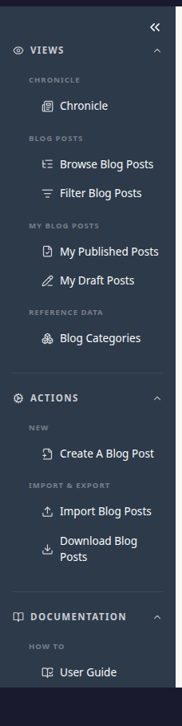

- **New** creates something: Create A Blog Post in Chronicle, Write A Recipe in Cookbook, Create Event and Create Person in Occasions.
- **Import & Export** loads things in from a file, or downloads them into one.
- **My Blog Posts** and **My Recipes**, under Views, list your own published work and your drafts.

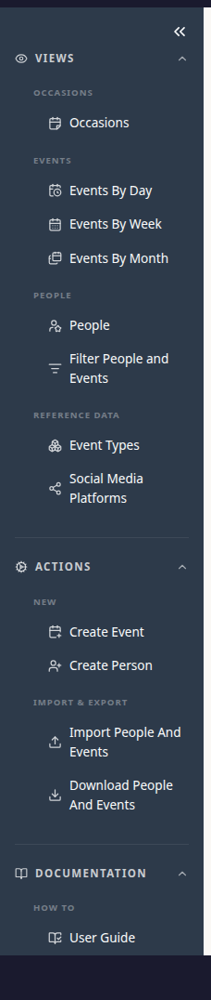

## Dossier: Your Career, Privately

>  Dossier is the app Gary skipped. It's where I keep my whole working life, so I can build a CV whenever I need one.

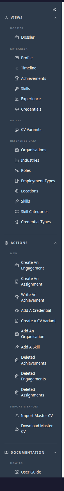

Everything in Dossier is **Restricted**: other users never see it, and there's no visibility to choose. (Like every Restricted thing, admins can open it.)

- **My Career** holds your Profile, your **Timeline** of jobs (Engagements, each with the Assignments you did there), your Achievements, Skills, Experience and Credentials.
- **My CVs** builds a CV for a particular job by choosing what to include, without deleting anything from the rest.
- **Import & Export** reads a master CV in and downloads one.

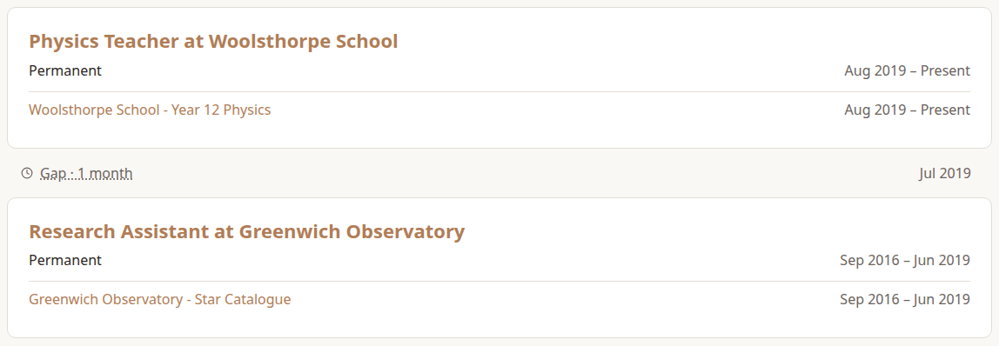

## Creating Something

>  Every app works the same way, so here's how I wrote a fourth Newton post, on optics.

Choose **Create A Blog Post** under Actions › New. Fill in the form. These pages don't describe every field, just the parts worth knowing:

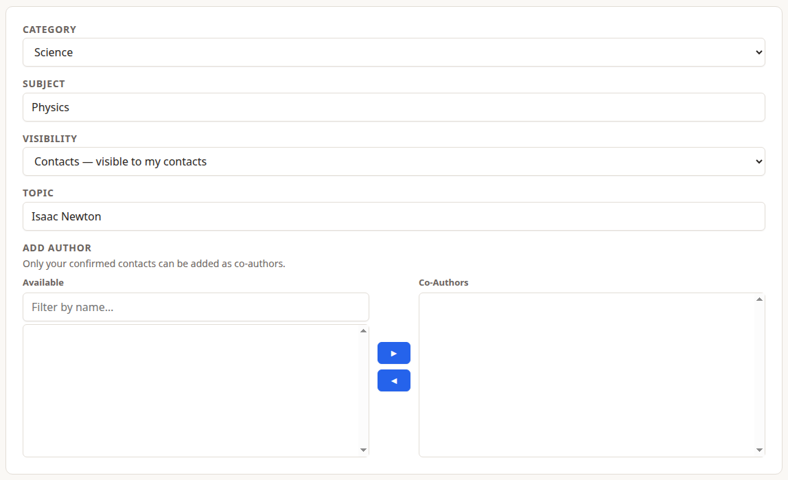

- **Visibility** decides who sees it. It's explained in full below.
- **Category**, **Subject** and **Topic** file the post, so readers can browse down to it.
- **Add Author** adds co-authors. They can see the draft, and if they're Content Creators too, they can edit it. Only your contacts can be added.

Choose **Save Blog Post**. The post is saved as a **draft**.

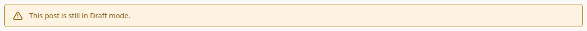

Only you (and any co-authors) can see a draft, whatever its visibility. When it's ready, choose **Publish** at the bottom of the post. **Unpublish** turns it back into a draft.

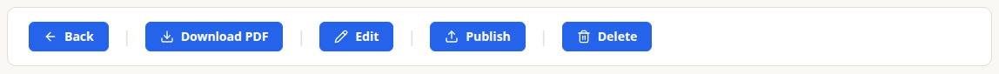

Recipes work the same way, drafts included. People and events in Occasions have no draft stage: they're visible, at their visibility, as soon as you save them.

## Visibility in Full

>  This is why Gary saw one of my Newton posts and Ulrika saw two. I chose who sees each one.

Every post, recipe, person and event has one of three visibilities, chosen by whoever adds it:

- **Unrestricted:** everyone, including guests who aren't signed in. My Isaac Newton post and Ulrika's birthday.
- **Contacts:** my contacts, and me. The Laws of Motion post, Erik and Maja's wedding, my kanelbullar.
- **Restricted:** only me. My Universal Gravitation notes and Maja's birthday.

A few things to know:

- **Contacts means *your* contacts.** When Ulrika and I connected, Ulrika started seeing my Contacts things, but not Contacts things from anyone Ulrika isn't connected to.
- **Admins see everything,** whatever its visibility.
- **You can change it at any time.** Choose **Edit** and pick another visibility. The change takes effect straight away.
- **Each app starts new things at a default visibility,** which you choose in that app's settings (see below).
- The People and Events lists show each item's visibility as an icon, and let you filter by it (see Ulrika's chapter).

## Editing and Deleting

**Edit** and **Delete** are at the bottom of everything you own. Before anything is deleted, you're asked to confirm:

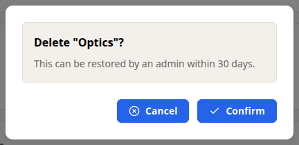

What happens next depends on the app:

- **Blog posts and recipes** are kept for **30 days**. They disappear from every list straight away, but an admin can restore them during those 30 days. After that they're gone for good.

  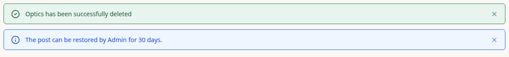

- **Dossier Engagements, Assignments and Achievements** are also kept for 30 days, but you restore them yourself: **Deleted Engagements**, **Deleted Assignments** and **Deleted Achievements** are under Actions, with the days left for each.

  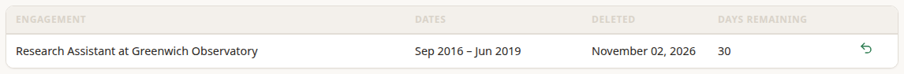

- **People and events in Occasions** are deleted **immediately and for good**. There's no undo, so the confirmation is your last chance. An event always needs at least one person, so deleting someone also deletes any event that only they were in.

>  I learned that last one the hard way.

## App Settings

>  Ulrika only needs each app's Start Page. The rest of its settings are for people like me.

Open **User Settings**, then the app under **App Settings**.

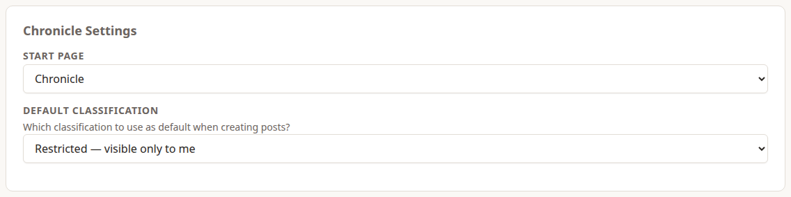

- **Start Page:** where you land when you open the app.
- **Default Classification:** the visibility a new post, recipe, person or event starts with. You can still change it on the form.

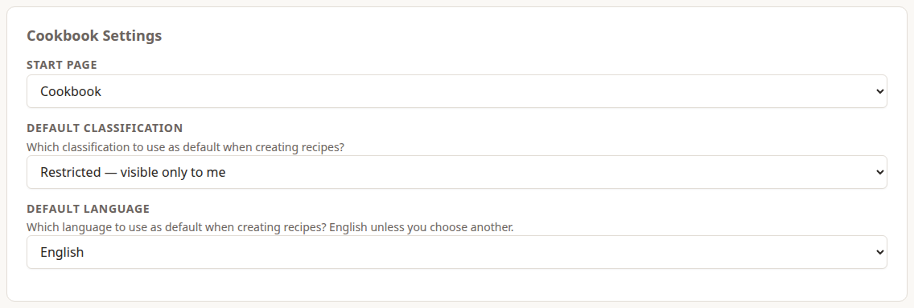

Cookbook also has a **Default Language** for new recipes. Occasions has a Start Page and Default Classification. Dossier has no settings page.

## What I Can't Do: Reference Data

The categories that content is filed under are **Reference Data**: Blog Categories, Cuisines, Food Types, Languages, Event Types and Social Media Platforms. Everyone can see them, but only admins can add, change or delete them. So when I wanted a new Blog Category, I had to ask.

The exception is Dossier, where Content Creators can add **Organisations** and **Skills** themselves (**Add An Organisation** and **Add A Skill**), because everyone's career is different.

>  There's no button for asking yet, so I asked Adam directly. Adam looks after Reference Data, and the next chapter is Adam's.
