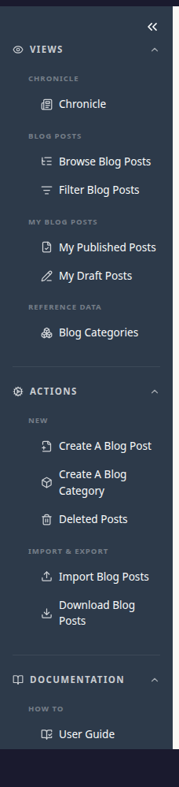
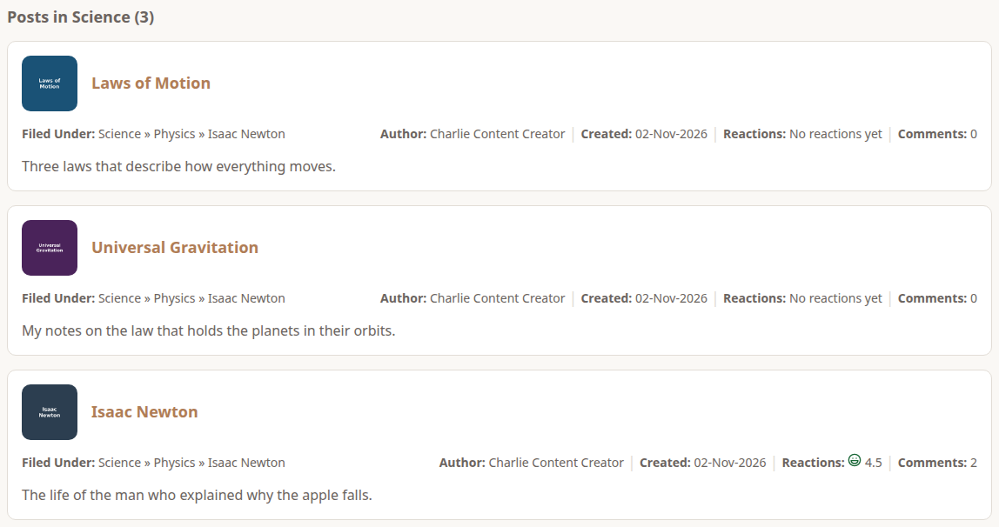
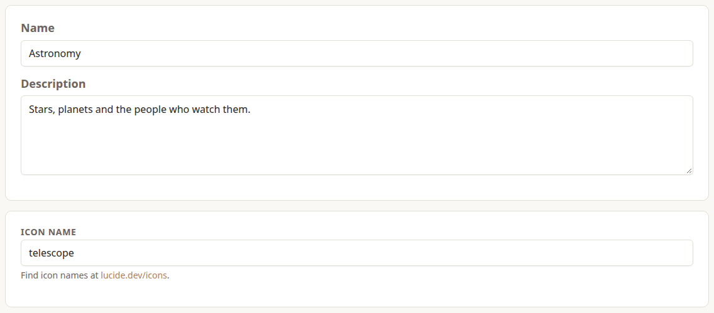
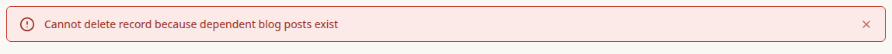
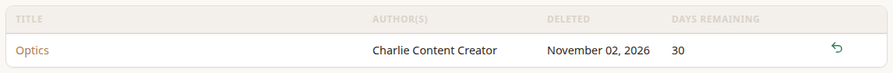

>  I'm Adam, an **admin**. I can do everything Charlie can, but my real job is looking after the things everyone shares: the lists content is filed under, and anything deleted by mistake.

## What an Admin Gets

An admin's **Actions** section has a few more entries than a Content Creator's: one to add each kind of Reference Data, and a **Deleted** page in Chronicle and Cookbook.

Admins also see everything, whatever its visibility. All three of Charlie's Newton posts show up for me, including the Restricted one only Charlie could see:

>  Admins can also edit or delete anyone's posts, recipes, people, events and comments. I only do that when something needs fixing, and I tell the author first.

## Reference Data

Reference Data is the set of lists that content is filed under. Keeping them in one place, looked after by admins, means everyone files under the same names: one **Science**, not *Science*, *science* and *Sciences*.

Each app has its own:

- **Chronicle:** Blog Categories.
- **Cookbook:** Cuisines, Food Types and Languages.
- **Occasions:** Event Types and Social Media Platforms.
- **Dossier:** Industries, Roles, Locations, Employment Types, Skill Categories and Credential Types. Content Creators add Organisations and Skills themselves; admins edit and delete them, and can **merge** two Skills that turn out to be the same thing.

Everyone can see these lists under **Reference Data** in each app's left menu. Only admins see the **Add** and **Create** links under Actions, and the **Edit** and **Delete** buttons on each item.

### Adding One

>  Charlie asked me for a Blog Category for their observatory posts, so I added Astronomy.

Most Reference Data has a **Name** and a **Description**. Blog Categories, Food Types and Event Types also have an **icon**, which stands in for a post, recipe or event that has no picture of its own. Cuisines and Languages have a flag instead. Icon names come from [lucide.dev/icons](https://lucide.dev/icons/).

- **Names must be unique,** ignoring capitals, so nobody can add *astronomy* next to *Astronomy*.
- **Changing a name** changes it everywhere it's used, straight away.

### Deleting One

Reference Data **can't be deleted while anything uses it**. That includes deleted posts and recipes that can still be restored.

To retire one, move everything filed under it to something else first, then delete it. Deleting Reference Data is permanent: there's no Deleted page for it.

The *Managing … Reference Data* page for each app lists that app's rules.

## Restoring Deleted Posts and Recipes

Charlie explained that deleted blog posts and recipes are kept for 30 days. Restoring them is my job.

**Deleted Posts** (in Chronicle) and **Deleted Recipes** (in Cookbook) are under **Actions**. They list everything deleted in the last 30 days, newest first, with how many days each has left:

Choose the restore button at the end of the row. The post or recipe comes back exactly as it was, published or draft, with its comments and reactions. After 30 days it's removed for good, and nobody can bring it back.

A few things aren't on these pages:

- **Dossier Engagements and Achievements** are restored by their owner, from their own Deleted pages (see Charlie's chapter).
- **People and events in Occasions** are deleted immediately, so there's nothing to restore.
- **Reference Data** can't be restored either.

## What I Can't Do: User Management

>  I can't approve sign-ups, suspend anyone, or change anyone's role. That's a separate job, for the **system admin**.

So if Ulrika wants to become a Content Creator, the system admin is the one to ask, not me. There's no button for asking yet, so for now it's done in person.

>  That's the end of the story. The rest of this User Guide has a page for each app, with the step-by-step detail.
