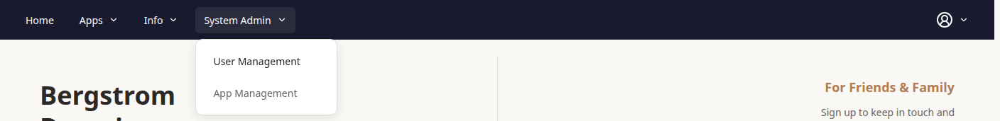
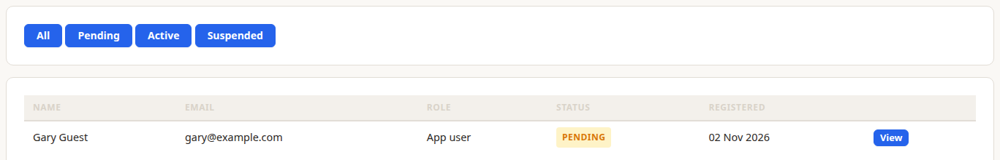
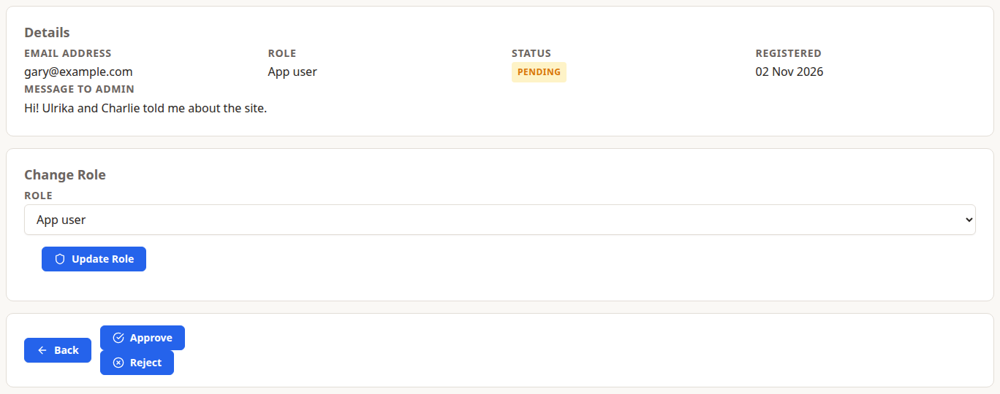
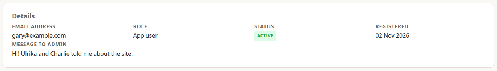
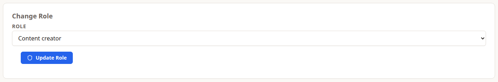

>  I'm Sam, the **system admin**. I decide who gets in and what they're allowed to do. Only system admins can see this page: it isn't part of the story the others tell.

A system admin can do everything an admin can (see Adam's chapter), plus manage the people who use the site.

## The System Admin Menu

System admins get one more menu in the top bar.

- **User Management** lists everyone who has signed up, and is where you approve, reject, suspend and change roles.
- **App Management** isn't built yet.

## Reviewing a Sign-Up Request

>  When Gary signed up (chapter 2), Gary's request came to me.

Open **User Management** and choose **Pending** to see the requests waiting for you.

Choose **View** to open one. You'll see what they told you about themselves in **Message to Admin**.

- **Approve** makes the account **Active**. They sign in with the email address and password they chose.
- **Reject** deletes the request permanently, after you confirm. They can sign up again later.

Everyone starts as a **User**, whatever they ask for. Change their role afterwards if they need more (see below).

> **Pending:** the site doesn't send emails yet. Approving, rejecting and suspending are meant to email the person, so for now, tell them yourself. A pending account can also already sign in before it's approved; until that's fixed, approve or reject requests promptly.

## Roles

Each person has one role, and each role can do everything the one before it can:

- **User:** comments, reactions, contacts and settings (Ulrika's chapter).
- **Content Creator:** creates, edits and deletes their own posts, recipes, people and events, and uses Dossier (Charlie's chapter).
- **Admin:** looks after Reference Data, restores deleted posts and recipes, and can see, edit and delete everyone's content (Adam's chapter).
- **System admin:** everything, plus User Management.

>  Ulrika asked to start writing recipes, so I made Ulrika a Content Creator.

Open the person from **User Management**, choose their new role under **Change Role**, then choose **Update Role**. It takes effect straight away.

Be careful with your own role: nothing stops you changing it, and once you're not a system admin, only another system admin can change it back.

## Suspending Someone

**Suspend** on an active person's page blocks their account, after you confirm. **Reactivate** on a suspended person's page lets them back in. You can't suspend yourself.

Suspending doesn't delete anything: their posts, recipes and comments stay as they are.

> **Pending:** a suspended account can still sign in. Until that's fixed, suspending only changes the account's status.

## Restoring Data

>  Restoring works the same for me as for Adam.

- **Blog posts and recipes:** use **Deleted Posts** and **Deleted Recipes**, under Actions in Chronicle and Cookbook, within 30 days (see Adam's chapter).
- **Dossier Engagements, Assignments and Achievements:** only their owner can restore them, from their own Deleted pages, within 30 days.
- **People and events in Occasions, and Reference Data:** deleted immediately and for good. There's no way to restore them from the site.
- **Rejected sign-up requests:** deleted for good. The person can sign up again.
